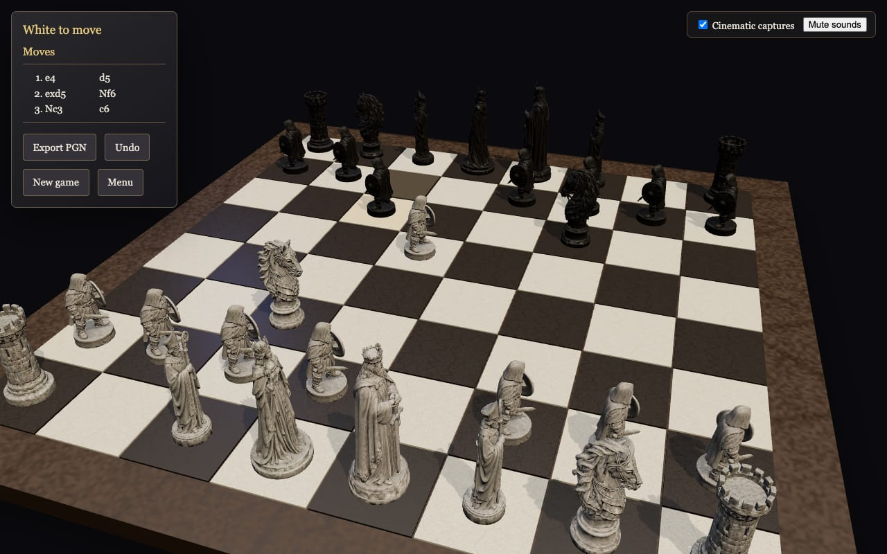
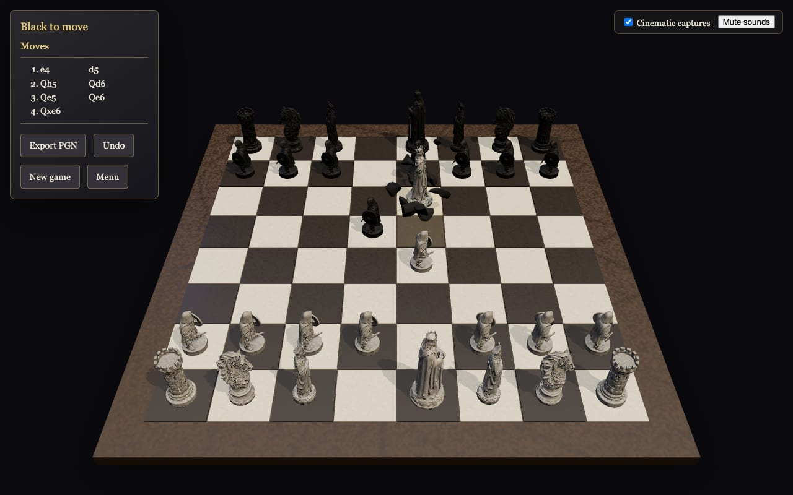

# Magic Chess

A realistic 3D chess game in the browser, inspired by "wizard chess": carved stone
pieces glide across the board on their own, and captured pieces shatter into debris
and dust. Play against Stockfish or a friend on the same computer.

**Play online: [chess.wahh.dev](https://chess.wahh.dev)**





## Features

- A title menu over in-engine key art (no 3D scene until you start), match setup, a
  full-screen loading screen with real progress and tips, and a cinematic camera arrival.
- Full chess rules (castling, en passant, promotion, every draw rule).
- Stockfish opponent with five difficulty levels, running in a Web Worker.
- Realistic stone piece models, animated moves, and physics-based shattering.
- Cinematic camera on major captures, stone sounds, last-move highlight.
- Torchlit stone chamber, stepped dais, CC0 PBR masonry, vaulted arches, fog and dust.
- Persistent **Graphics High / Low** selector in the settings bar. High adds ambient
  occlusion, subtle flame bloom, filmic tone mapping and vignette; Low removes the
  post-processing pipeline and torch shadows, and reduces lights, dust and pixel density.
  Both retain the board's key light and cool fill. Orbit lower / zoom out to see the hall.
- Undo, optional chess clock (5+0, 10+5, 15+10), autosave with "Continue game",
  and PGN export/import.

## Run it

Requires Node 24 and pnpm.

```sh
pnpm install
pnpm dev        # http://localhost:5173
```

Other commands:

| Command | What it does |
|---------|--------------|
| `pnpm test` | Unit tests (Vitest) |
| `pnpm typecheck` / `pnpm lint` | TypeScript and ESLint |
| `pnpm build` | Production build in `dist/` |
| `node scripts/smoke.mjs` | Browser smoke test (needs `pnpm dev` running and Google Chrome) |
| `node scripts/scenarios.mjs` | Browser rule/feature scenarios (`SCENARIO=<name>` runs one) |
| `pnpm models` | Cleans the piece models in `assets/models/source/` into `public/models/` |

Every push to `main` is deployed to GitHub Pages (`.github/workflows/pages.yml`) at
[chess.wahh.dev](https://chess.wahh.dev). CI (GitHub Actions, `.github/workflows/ci.yml`) runs the unit tests, type check, lint,
build, and the browser smoke test on every pull request. The slower browser scenarios
run on demand: *Actions → CI → Run workflow → scenarios*.

## Project layout

- `src/core` — game rules, commands, engine, clock, PGN (no rendering code).
- `src/scene` — the 3D board, pieces, animation, fracture, debris, camera.
- `src/ui` — game store and screens. `src/audio` — sound playback.
- `docs/architecture.md` — design principles and decisions D1–D17.
- `docs/performance.md` — loading performance: how it is measured, numbers, what remains.
- `src/scene/environment` — decorative `Chamber` (`quality="high" | "low"`),
  deterministic flicker, layout and quality presets. Reflections use local Lightformers,
  so the chamber makes no third-party runtime requests.
- `docs/models/generation-guide.md` — how the piece models were generated.

## License

The game's source code is released under the [MIT License](LICENSE). Third-party
assets and the chess engine keep their own licenses, listed below.

## Credits and licenses

- **Piece models:** © 2026 Wilmer Henao, generated with [Meshy](https://www.meshy.ai)
  (paid plan) and released under
  [CC BY 4.0](https://creativecommons.org/licenses/by/4.0/) — credit: "Magic Chess piece
  models by Wilmer Henao, CC BY 4.0". Details: `public/models/LICENSE.md`.
- **Environment textures:** Poly Haven **Stone Floor** (Dimitrios Savva) and
  **Stone Wall 02** (Charlotte Baglioni / Dario Barresi), CC0. Six 1K WebP PBR maps,
  under 1 MB total. Source URLs and conversion details: `public/environment/LICENSE.md`.
- **Key art:** rendered in-engine from the ARCANA piece models by Wilmer Henao,
  [CC BY 4.0](https://creativecommons.org/licenses/by/4.0/). Details: `docs/art.md`.
- **Sounds:** [Kenney Impact Sounds](https://kenney.nl/assets/impact-sounds), CC0.
  Details: `public/sounds/LICENSE.md`.
- **Chess engine:** [Stockfish](https://stockfishchess.org) via
  [stockfish.js](https://github.com/nmrugg/stockfish.js), GPLv3. The engine runs as a
  separate program in a Web Worker; its license is copied to `public/stockfish/` at
  build time.
